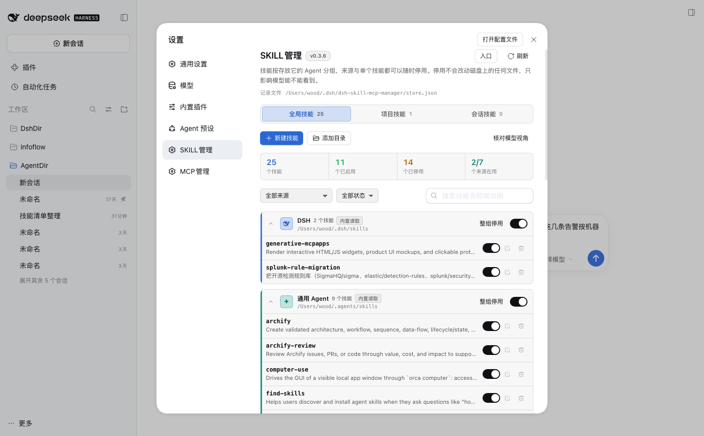
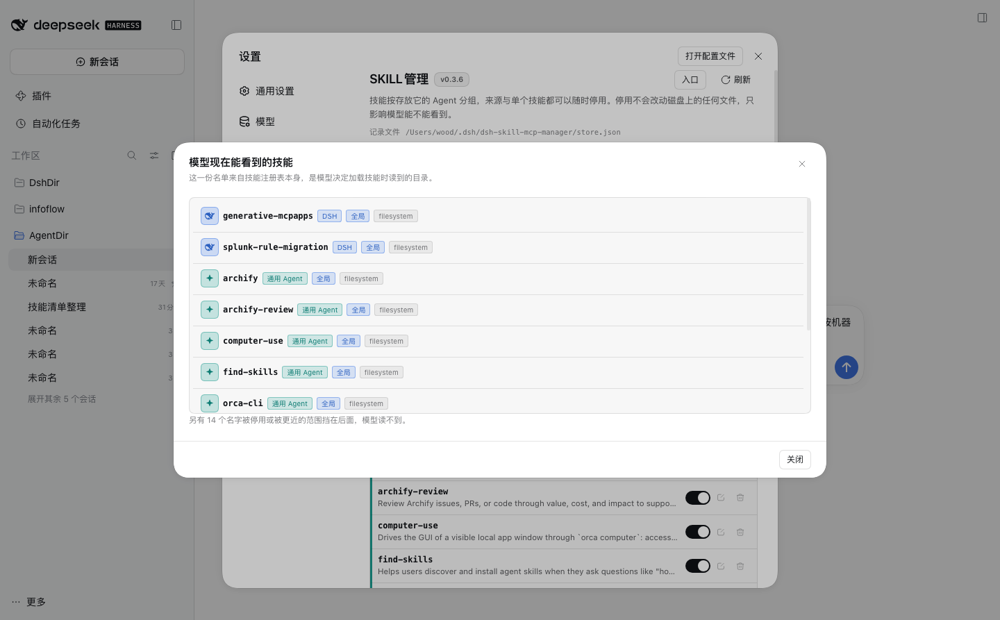
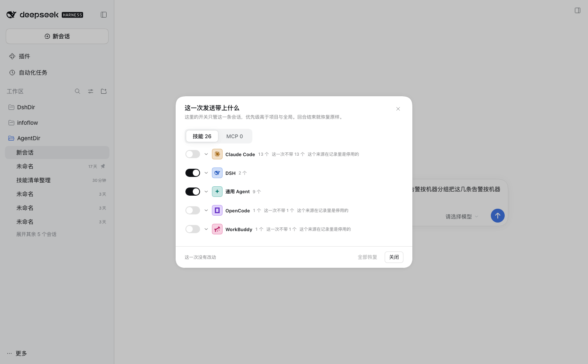
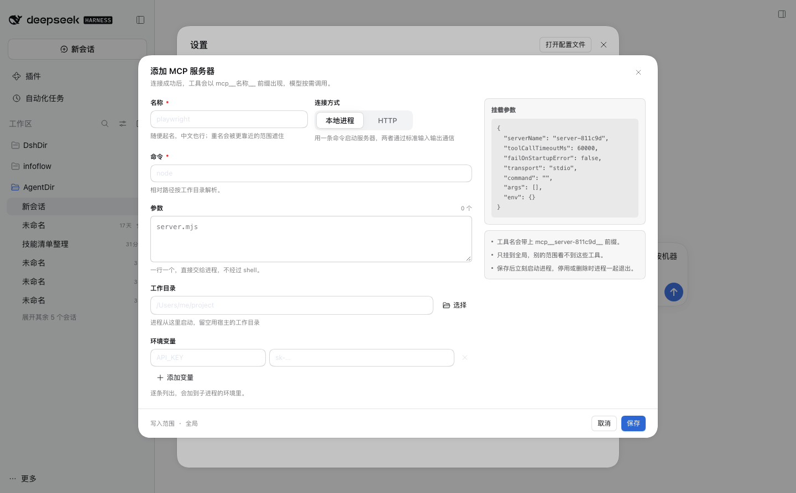
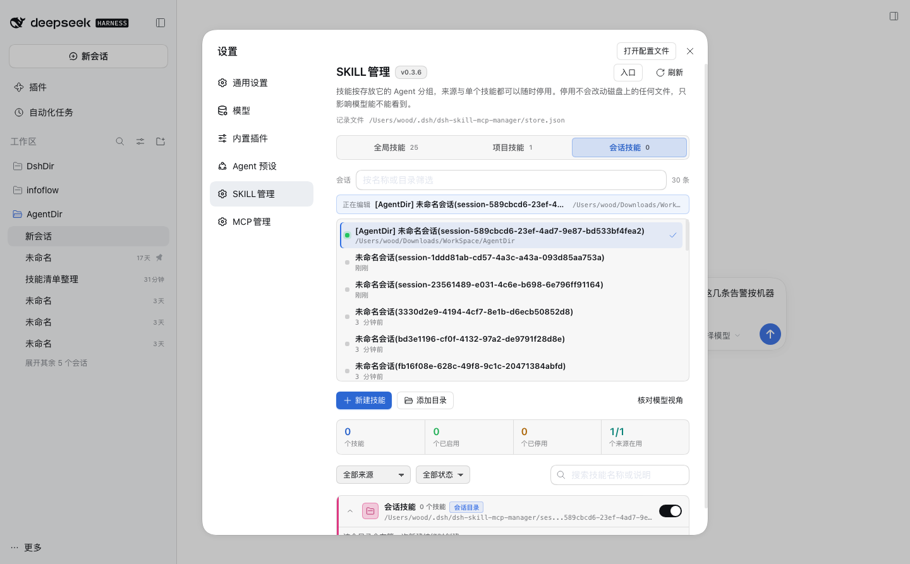

<p align="center">
  
</p>

<div align="center">

# dsh-skill-mcp-manager

**让每一层工作范围自己决定：模型能看到哪些技能、哪些 MCP 工具**

[更新日志](CHANGELOG.md) · [架构](docs/architecture.md) · [开发](docs/development.md) · [Apache-2.0](LICENSE)

[](LICENSE)
[](https://github.com/deepseek-ai/deepseek-harness)
[](package.json)

</div>

## 它是干什么的

DSH 的模型每轮能看到一份技能清单和一批 MCP 工具。清单太长会挤占上下文，太短又缺东西；而"够不够"这件事在每条会话上要求还不一样。

这个插件把这件事搬到界面上：技能按它所在的目录分组，MCP 服务器按连接分组，两样都能在**全局、项目、会话**三层分别启停。改完刷新页面就生效，模型看不到的东西只是看不见，磁盘上的文件一个字节都不动。

三处入口，想在哪改就在哪改：设置左栏两个管理页、主页左侧栏两个图标、对话页顶部两个 tab。对话输入框左下角还有一个胶囊按钮，管"这一次发送"临时带上什么。

## 功能概览

- **认识本机所有 agent 的技能目录**：DSH、通用 Agent、Claude Code、Codex、Gemini CLI、Cursor、GitHub Copilot、OpenCode、Windsurf、Trae、Qoder、Roo Code、CodeBuddy、WorkBuddy、OpenClaw，一共 15 行来源；本机存在的目录自动列出，也可以手动指到别处。
- **三层作用域**：`全局` 对每条会话生效，`项目` 对工作目录在同一个项目根下的会话生效，`会话` 只在那一条里生效。越具体的压过越笼统的。
- **按来源、按技能启停**：关一个来源，它带的技能一起消失；关一个技能，只有它消失。整组关掉之后还能单独把其中某个打开，那一行会标「整组关着，单独开着」。
- **同名不再互相掩盖**：两个来源有同名技能时，页面把"被更靠前的来源接管"标出来，不会出现开关点了没反应。
- **技能增删改查**：新建（目录形式或单文件）、改名称 / 说明 / 什么时候用 / 正文、删除。改名称时旧目录一起清掉，不留两份。
- **MCP 增删改查**：本地进程与 HTTP 两种连接，命令、参数、工作目录、环境变量、请求头都能配；环境变量与请求头一条一行填键和值，值里可以有等号。可以只停用不删除。
- **核对模型视角**：一个按钮按目录算出模型此刻真正看到的技能名、来源、作用域和供应商。全局作用域不需要有在线会话也有结果。
- **临时开关**：输入框左下角打开一张表，按 agent 分组，每组左侧一个开关能一次整组带或不带。这些开关只属于当前这条会话，优先级高于项目与全局，这一轮回答结束自动清空。
- **四处显示位置各自开关**：左侧栏两个图标、对话页两个 tab，四个开关在页头的「入口」弹窗里，也在插件自己的详情页里，关掉的立刻收起。
- **操作反馈走提示条**：保存、删除、启停的结果从页面顶部弹一条，自动消失，正文不会因为提示出现而挪位置。

## 界面预览

技能管理页按 Agent 分组，每个来源一行标题，下面是它提供的技能和各自的开关：



「核对模型视角」直接读注册表，看模型这一刻拿到了哪些名字：



对话页输入框左下角的 `SKILL·MCP` 只管这一条会话，点开按 Agent 分组：



MCP 服务器编辑器左边填、右边即时显示挂载参数，环境变量与请求头一条一行填键和值：



会话级的技能目录挑一次就够，列表里是会话名称与项目目录：



## 安装

先确认本机能跑 `dsh`。下面的命令用 `web` profile，换成自己的即可。

```bash
# npm 上的包
dsh plugin --profile web add @awoodwhale/dsh-skill-mcp-manager

# 或者这个仓库的本地副本（先在仓库里跑 npm install，prepare 会构建出 lib/）
dsh plugin --profile web add /absolute/path/to/dsh-skill-mcp-manager
```

仓库里带一个脚本，省掉记路径：

```bash
bash scripts/install.sh                      # 发布包，profile web
bash scripts/install.sh my-profile           # 换个 profile
bash scripts/install.sh web .                # 用这个仓库（本地开发）
```

装完**重启一次 `dsh web`**。profile 的 bundle 行只在启动时读，不重启等于没装。

重启后设置左栏多出 **SKILL管理** 与 **MCP管理** 两项。想确认它真的加载了：

```bash
cat ~/.dsh/dsh-skill-mcp-manager/state.json
```

里面写着这次加载的版本、记录文件位置、当前连上的条数。

```bash
dsh plugin --profile web update @awoodwhale/dsh-skill-mcp-manager   # 升级
dsh plugin --profile web remove @awoodwhale/dsh-skill-mcp-manager   # 卸载，记录文件与技能文件都留在原地
```

## 使用

| 想做的事 | 怎么做 |
|---|---|
| 关掉某个 agent 的全部技能 | 技能页里找到那张来源卡片，点右上「整组停用」 |
| 整组关掉之后单独开一个 | 直接点那一行的开关，行上会出现「整组关着，单独开着」 |
| 让某个技能只在这一条会话里出现 | 切到「会话技能」tab，选会话，点「新建技能」；或在项目 / 全局关掉、在会话里打开 |
| 只给这个项目加一个技能 | 切到「项目技能」tab，选项目根，点「新建技能」 |
| 换个目录读技能 | 来源卡片上「换一个目录」，或者「添加目录」指一个绝对路径 |
| 看一眼模型到底能看到什么 | 点「核对模型视角」 |
| 加一个 MCP 服务器 | MCP 页点「添加服务器」，选本地进程或 HTTP |
| 只让这一条会话用某个 MCP | 切到会话作用域再加，或加在全局后在会话里停用 |
| 这一次发送临时不带某个技能 | 输入框左下角的 `SKILL·MCP` 按钮 |
| 把左侧栏图标或对话页 tab 收起来 | 页头「入口」按钮，四个开关 |

### 三层作用域怎么排

```
会话  >  项目  >  全局
```

同名的技能、同名的 MCP 服务器，只有最近的那一层生效。同一层里，排在列表前面的来源压过后面的。

会话这一层挑的是会话本身：有标题就显示标题，没有标题就显示 `未命名会话(session-…)`，一排同名会话也不会认错。

### 关闭到底改了什么

只改这个插件的记录文件，不写、不挪、不删磁盘上的任何技能文件。

关掉的东西在它所在的那一层发布一个同名但不可调用的占位，内置的目录读取器即使读到了那个文件，模型也拿不到它。删掉记录，一切回到原始状态。

### 技能的写法

目录形式是 `<名称>/SKILL.md`，也可以是一个单文件 `<名称>.md`，开头一段 YAML：

```markdown
---
name: splunk-query
description: 查 Splunk 安全日志，支持离线与在线两个集群
---

正文……
```

`name` 用小写字母、数字、连字符。目录名里带中文也能读，只要 frontmatter 给了合法的 `name`。

## 支持的 agent 目录

`~` 是用户主目录，`<项目根>` 是会话工作目录所属的那个项目。设了环境变量就以环境变量为准。

| 来源 | 全局目录 | 环境变量 | 项目目录 |
|---|---|---|---|
| DSH | `$DSH_HOME/skills` | `DSH_HOME` | `<项目根>/.dsh/skills` |
| 通用 Agent | `~/.agents/skills` | `DSH_AGENTS_HOME` | `<项目根>/.agents/skills` |
| Claude Code | `~/.claude/skills` | `DSH_CLAUDE_HOME` | `<项目根>/.claude/skills` |
| Codex | `~/.codex/skills` | `DSH_CODEX_HOME` | `<项目根>/.codex/skills` |
| Gemini CLI | `~/.gemini/skills` | `DSH_GEMINI_HOME` | `<项目根>/.gemini/skills` |
| Cursor | `~/.cursor/skills` | `DSH_CURSOR_HOME` | `<项目根>/.cursor/skills` |
| GitHub Copilot | `~/.copilot/skills` | `DSH_COPILOT_HOME` | `<项目根>/.github/skills` |
| OpenCode | `~/.config/opencode/skills` | `DSH_OPENCODE_HOME` | `<项目根>/.opencode/skills` |
| Windsurf | `~/.codeium/windsurf/skills` | — | `<项目根>/.windsurf/skills` |
| Trae | `~/.trae/skills` | — | `<项目根>/.trae/skills` |
| Qoder | `~/.qoder/skills` | — | `<项目根>/.qoder/skills` |
| Roo Code | `~/.roo/skills` | — | `<项目根>/.roo/skills` |
| CodeBuddy | `~/.codebuddy/skills` | — | `<项目根>/.codebuddy/skills` |
| WorkBuddy | `~/.workbuddy/skills` | — | `<项目根>/.workbuddy/skills` |
| OpenClaw | `~/.openclaw/skills` | — | — |

- DSH 与通用 Agent 开箱就是开的，其余默认关着，点一下开就行。
- 本机不存在的目录不出现在列表里。已经配过、后来被删掉的目录会留在列表上并标出"目录还不存在"，方便改回去。
- 会话这一层只有一个来源：`$DSH_HOME/dsh-skill-mcp-manager/sessions/<会话 ID>/skills`，默认开着，第一次在里面新建技能时创建。
- 表外的 agent 不用等发版：点「添加目录」指过去即可，额外目录以绝对路径作为键，排在表后面。

> DSH 自己的目录会被宿主扫一遍。本插件不重复发布它，只做启停判断——关掉 DSH 来源里的技能靠的是同名占位，而不是重新扫一遍目录。

## MCP 服务器

| 字段 | 说明 |
|---|---|
| 名称 | 随便写，中文也行。它只是给人看的标签，工具名前缀用的是另一个"挂载名" |
| 连接方式 | 本地进程（`stdio`）或 HTTP |
| 命令 / 地址 | `stdio` 填命令，例如 `node`；HTTP 填 URL |
| 参数 | 一行一个 |
| 工作目录 | `stdio` 的启动目录，可以从目录选择器里挑 |
| 环境变量 | 一条一行，左边键、右边值 |
| 请求头 | 一条一行，左边键、右边值。值不裁剪，`==` 与签名里的空格都原样保留 |

工具名长这样：

```
mcp__<挂载名>__<工具名>
```

名称能直接当标识符就原样用，不能的话（中文、空格、太长）就清洗成字母数字加一段短后缀，例如 `有效中心` 会挂成 `server-80d688`。编辑器右栏的「挂载参数」就是把名字派生出来的结果，写进去之前能看见。

服务器卡片上列出当前连上的工具名。会话还没有活动时显示「会话未激活」——连接要等会话真正跑起来才建立。

## 临时开关

对话输入框左下角有一个胶囊按钮，跟旁边选权限的按钮同高同色：

- 没改动时显示 `SKILL·MCP`，有改动时显示 `SKILL·MCP 2`。
- 打开后顶部按「技能」「MCP」分开，下面按 agent 分组，组头有来源名和数量，左侧一个开关能一次带上或拿掉整组。
- 每组默认收起，几十个技能不会一次铺满整屏。
- 关掉的一行名称加删除线并标「这一次不带」，把停用来源里的技能拉起来的一行标「这一次带上」。
- 这些开关只属于当前这条会话，优先级高于项目与全局：会话里关掉的，项目与全局都拉不回来。
- 「全部恢复」清空这一轮的所有临时改动。
- 这一轮回答结束（`agent/turn-stopping`）自动清空，下一条消息回到持久配置。

## 存储

所有配置在一个文件里，三个作用域共用：

```
$DSH_HOME/dsh-skill-mcp-manager/
  store.json                   # 三个作用域的配置、显示位置、每条会话的临时开关
  state.json                   # 本次加载的心跳
  sessions/<会话 ID>/skills/   # 会话级技能的默认目录
```

```json
{
  "version": 3,
  "prefs": { "sidebarSkills": false, "sidebarMcp": false, "tabSkills": false, "tabMcp": false },
  "global": {
    "sources": {
      "dsh": { "enabled": null, "dir": "", "disabled": ["some-skill"], "forced": [] },
      "/Users/me/work/shared-skills": { "enabled": true, "dir": "", "disabled": [], "forced": [] }
    },
    "mcpServers": []
  },
  "projects": {},
  "sessions": {
    "session-0000": {
      "sources": {},
      "mcpServers": [],
      "temp": { "offSkills": ["x"], "onSkills": [], "offServers": [], "onServers": [] }
    }
  }
}
```

| 字段 | 含义 |
|---|---|
| `sources` 的键 | 目录表里的来源 id，或者一个绝对路径（额外添加的目录） |
| `enabled` | `null` 跟随目录表默认值，`true` / `false` 是用户明确开的或关的 |
| `dir` | 空表示用默认位置，有值表示读这个目录 |
| `disabled` | 这个来源里被单独关掉的技能名 |
| `forced` | 整组关掉之后又被单独打开的技能名 |
| `prefs` | 四个显示位置开关 |
| `temp` | 这一轮的临时改动：多关掉的与多打开的 |

整个 `store.json` 由插件自己管理。宿主注册了一个写入拦截，模型的文件工具改不动它——想改就点界面。

## 配置项

写在 profile 的 bundle 行上，两个都可以不写：

| 键 | 默认 | 含义 |
|---|---|---|
| `storePath` | 空（`$DSH_HOME/dsh-skill-mcp-manager/store.json`） | 换一个记录文件位置 |
| `mount` | `true` | 关掉之后插件只当一个编辑器，不挂任何技能供应商与 MCP 连接 |

## 已知边界

- 只在 Web 端（`dsh web`）跑，没有命令行界面。
- 只管理本机目录里已有的技能与手动添加的服务器；不从 Git 仓库或市场安装。
- 关闭靠同名占位，所以整体关掉一个来源时，模型侧看到的是"同名但不可调用"，这些名字仍会出现一次。
- `stdio` 服务器由宿主启动与管理，插件负责在正确的作用域里连接与断开。

## 开发

想改代码、看架构、跑测试，看 [docs/development.md](docs/development.md) 与 [docs/architecture.md](docs/architecture.md)。

```bash
npm install
npm run build        # 生成远程描述符 → 编译宿主 → 打包浏览器半边
npm test
npm run typecheck
```

`test/fixture/mcp-server.mjs` 是一个零依赖的 MCP stdio 服务，提供 `echo` 与 `add` 两个工具，用来手工走一遍完整链路：MCP 页添加服务器，选「本地进程」，命令 `node`，参数 `test/fixture/mcp-server.mjs`，保存后卡片上应该出现两个 `mcp__…` 工具名。

## 发布

推一条 GitHub Release 就会发一次 npm。工作流在 [.github/workflows/release.yml](.github/workflows/release.yml)：

1. 在仓库的 Actions secrets 里放一个 npm 的 automation token，名字 `NPM_TOKEN`，账号要有 `@awoodwhale` 作用域的发布权限。
2. 改 `package.json` 的 `version`，在 `CHANGELOG.md` 里写一段，提交。
3. `gh release create v<版本> --title v<版本> --notes "<那一段>"`。

工作流会先校验 tag 与 `package.json` 的版本一致，再跑构建、生成物比对、类型检查与测试，最后 `npm publish --access public --provenance`。版本号对不上或测试不过都会停在发布之前。

## 反馈

遇到问题请带上：DSH 版本、插件版本（页头写着）、复现步骤，界面问题附截图。`~/.dsh/dsh-skill-mcp-manager/state.json` 里记录了当前加载的版本与产物路径，贴出来最快定位。

## 许可证

[Apache License 2.0](LICENSE)
