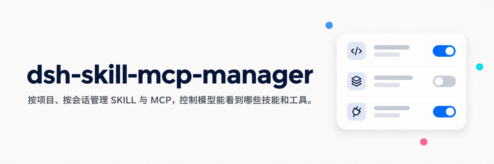
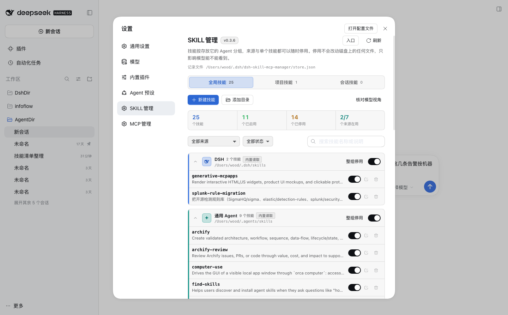
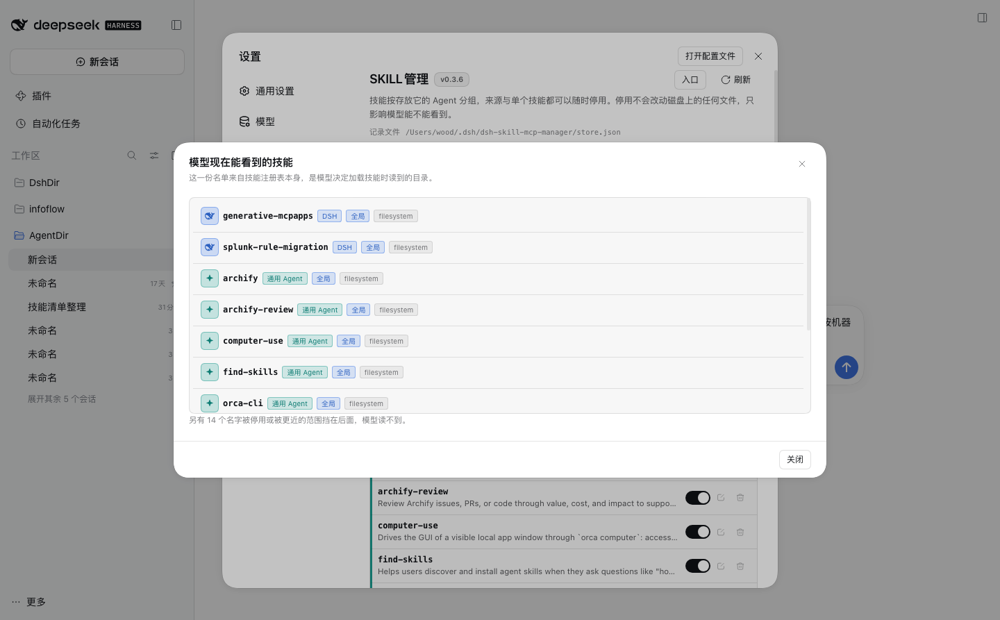
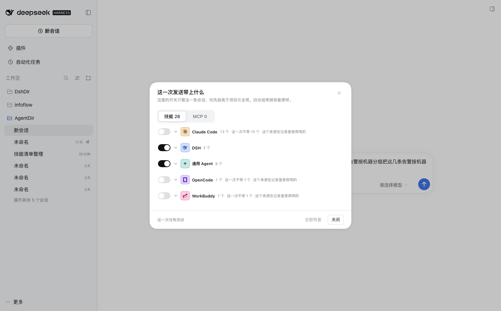
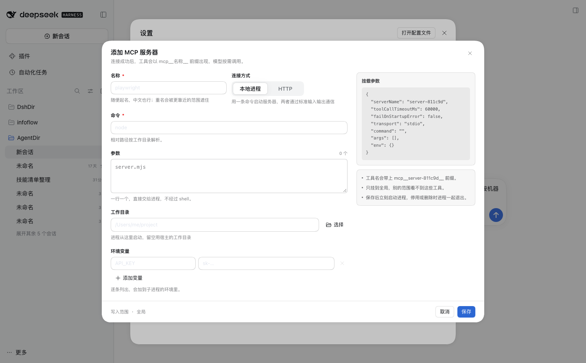
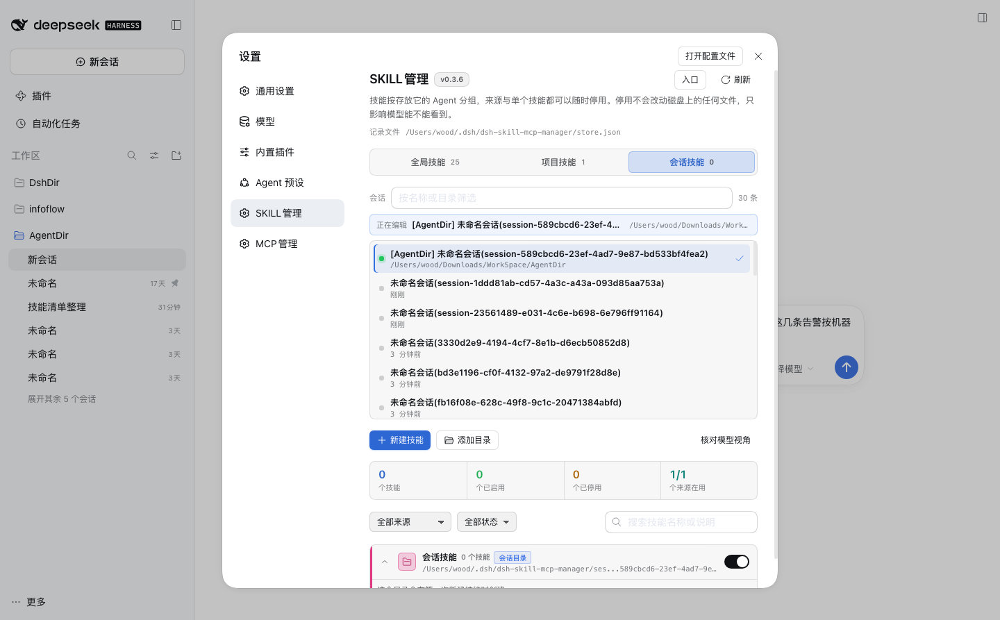

<p align="center">
  
</p>

<div align="center">

# dsh-skill-mcp-manager

**Every layer of work decides for itself which skills the model sees and which MCP tools it gets**

[中文](README.md) · [Changelog](CHANGELOG.md) · [Architecture](docs/architecture.md) · [Development](docs/development.md) · [Apache-2.0](LICENSE)

[](LICENSE)
[](https://github.com/deepseek-ai/deepseek-harness)
[](package.json)

</div>

## What it is for

On every turn the model reads one list of skills and one set of MCP tools. A long list eats the context; a short one leaves things out. Worse, "how much is enough" differs from one conversation to the next.

This plugin brings that decision onto the screen. Skills are grouped by the directory that holds them, MCP servers by the connection they use, and both can be switched at three scopes: **global, project, and conversation**. A change takes effect on the next page load; anything switched off simply cannot be seen, and not a single byte on disk changes.

Three entry points, so the change lands wherever you are: two manager pages in the settings sidebar, two icons in the home sidebar, two tabs above a conversation. A pill button at the bottom left of the composer covers one more case: what this message carries.

## What it does

- **Knows every agent's skill directories on this machine**: DSH, the shared Agent convention, Claude Code, Codex, Gemini CLI, Cursor, GitHub Copilot, OpenCode, Windsurf, Trae, Qoder, Roo Code, CodeBuddy, WorkBuddy, OpenClaw — fifteen sources in all. Directories that exist are listed automatically, and any other path can be pointed at by hand.
- **Three scopes**: `global` reaches every conversation, `project` reaches every conversation whose working directory sits under the same project root, `conversation` reaches that one conversation. The nearer scope wins.
- **Switches per source and per skill**: turning a source off removes every skill it holds; turning one skill off removes that skill alone. After a whole group is off, a single skill can still be switched back on, and its row says `Switched on`.
- **One owner per name**: when two sources hold a skill of the same name, the nearest copy decides. Switching that copy off removes the name from the whole scope, so no switch is ever left without an effect.
- **Create, edit, and delete skills**: a new skill (directory form or single file), then change its name, description, trigger, or body. Renaming clears the old directory away instead of leaving two copies.
- **Create, edit, and delete MCP servers**: local process or HTTP, with command, arguments, working directory, environment variables, and request headers. Environment variables and headers are filled one key and one value per row, and a value may contain an equals sign. A server can be switched off without being deleted.
- **Check the model view**: one button reads the registry and reports the skill names, sources, scopes, and providers the model actually reads at this moment. The global scope answers even with no live conversation.
- **Temporary switches**: the sheet at the bottom left of the composer groups skills by agent, and a switch at the left of each group carries or drops the whole group at once. These belong to the current conversation, sit nearer than project and global, and clear themselves when the turn ends.
- **Four display places, each switchable**: two sidebar icons and two conversation tabs are toggled from the `Places` sheet in the page header and from the plugin's own detail page; a place switched off is withdrawn at once.
- **Feedback through toasts**: saving, deleting, and switching all report from the top of the page and disappear on their own, so the body never shifts under a notice.

## Screenshots

The skill manager groups by agent: one header row per source, the skills it holds, and a switch on each.



`Check the model view` reads the registry itself, so you see exactly the names the model holds right now.



The `SKILL·MCP` pill at the bottom left of the composer covers this conversation only, grouped by agent:



The MCP server editor fills on the left and shows the mount arguments on the right; environment variables and headers take one key and one value per row.



The conversation skill page asks for a conversation first and orders the list by name and directory; a conversation without a title shows as `Unnamed session (session-…)`.



## Install

Make sure `dsh` runs on this machine. The commands below use the `web` profile; put your own in its place.

```bash
# the package on npm
dsh plugin --profile web add @awoodwhale/dsh-skill-mcp-manager

# or a local copy of this repository (run npm install inside it first; prepare builds lib/)
dsh plugin --profile web add /absolute/path/to/dsh-skill-mcp-manager
```

The repository ships a script that saves you the path:

```bash
bash scripts/install.sh                      # the published package, profile web
bash scripts/install.sh my-profile           # another profile
bash scripts/install.sh web .                # this repository (local development)
```

**Restart `dsh web` once** after installing. The profile reads its bundle lines at startup, so skipping the restart means the plugin is not loaded.

After the restart the settings sidebar has two more entries, **SKILL manager** and **MCP manager**. To confirm it really loaded:

```bash
cat ~/.dsh/dsh-skill-mcp-manager/state.json
```

It records the version loaded this time, where the record file sits, and how many connections are up.

```bash
dsh plugin --profile web update @awoodwhale/dsh-skill-mcp-manager   # upgrade
dsh plugin --profile web remove @awoodwhale/dsh-skill-mcp-manager   # uninstall; records and skill files stay where they are
```

## Use

| What you want | How |
|---|---|
| Switch off every skill of one agent | Find that source card on the skill page and press `Disable all` at its top right |
| Switch one skill back on after the whole group is off | Press that row's switch; the row then carries `Switched on` |
| Make a skill appear in this conversation only | Open the `Session skills` tab, choose the conversation, press `New skill`; or switch it off in project and global and on here |
| Add a skill for this project only | Open the `Project skills` tab, choose the project root, press `New skill` |
| Read skills from another directory | `Remove` or `Add directory` on a source card, pointing at an absolute path |
| See what the model really reads | Press `Check the model view` |
| Add an MCP server | On the MCP page press `Add server` and choose local process or HTTP |
| Let one conversation use an MCP server | Add it in the conversation scope, or add it globally and switch it off in the conversation |
| Drop a skill for this message only | The `SKILL·MCP` button at the bottom left of the composer |
| Withdraw a sidebar icon or a conversation tab | The `Places` button in the page header, four switches |

### How the three scopes stack

```
conversation  >  project  >  global
```

For a skill or an MCP server of the same name, only the nearest layer takes effect. Inside one layer, a source earlier in the list beats one later.

Switch the nearest copy off and the name disappears from that scope altogether: the model does not see it, the slash menu does not list it, and no farther layer brings the name back.

The conversation layer picks the conversation itself: its title when it has one, `Unnamed session (session-…)` when it does not, so a row of identical sessions is still told apart.

### What switching off actually changes

Only this plugin's record file. No skill file on disk is written, moved, or deleted.

Something switched off publishes a placeholder of the same name in its own layer, marked as not invocable, so the built-in directory reader may well read that file and the model still cannot reach it. Delete the record and everything returns to where it was.

### How a skill is written

The directory form is `<name>/SKILL.md`; a single file is `<name>.md`. Either way it opens with a YAML block:

```markdown
---
name: release-notes
description: Turn a week of commits into release notes, grouped by module
---

The body…
```

`name` uses lower-case letters, digits, and hyphens. A directory name may hold other characters, as long as the frontmatter gives a valid `name`.

## Agent directories

`~` is the home directory and `<project root>` is the project the conversation's working directory belongs to. An environment variable, when set, wins over the default.

| Source | Global directory | Environment variable | Project directory |
|---|---|---|---|
| DSH | `$DSH_HOME/skills` | `DSH_HOME` | `<project root>/.dsh/skills` |
| Shared Agent | `~/.agents/skills` | `DSH_AGENTS_HOME` | `<project root>/.agents/skills` |
| Claude Code | `~/.claude/skills` | `DSH_CLAUDE_HOME` | `<project root>/.claude/skills` |
| Codex | `~/.codex/skills` | `DSH_CODEX_HOME` | `<project root>/.codex/skills` |
| Gemini CLI | `~/.gemini/skills` | `DSH_GEMINI_HOME` | `<project root>/.gemini/skills` |
| Cursor | `~/.cursor/skills` | `DSH_CURSOR_HOME` | `<project root>/.cursor/skills` |
| GitHub Copilot | `~/.copilot/skills` | `DSH_COPILOT_HOME` | `<project root>/.github/skills` |
| OpenCode | `~/.config/opencode/skills` | `DSH_OPENCODE_HOME` | `<project root>/.opencode/skills` |
| Windsurf | `~/.codeium/windsurf/skills` | — | `<project root>/.windsurf/skills` |
| Trae | `~/.trae/skills` | — | `<project root>/.trae/skills` |
| Qoder | `~/.qoder/skills` | — | `<project root>/.qoder/skills` |
| Roo Code | `~/.roo/skills` | — | `<project root>/.roo/skills` |
| CodeBuddy | `~/.codebuddy/skills` | — | `<project root>/.codebuddy/skills` |
| WorkBuddy | `~/.workbuddy/skills` | — | `<project root>/.workbuddy/skills` |
| OpenClaw | `~/.openclaw/skills` | — | — |

- DSH and the shared Agent directory start out on; the rest start out off, one press away.
- A directory this machine does not have is not listed. A directory already configured and deleted later stays in the list marked as missing, so the path can be corrected.
- The conversation layer has one source: `$DSH_HOME/dsh-skill-mcp-manager/sessions/<conversation id>/skills`. It starts out on and is created when the first skill is written into it.
- An agent outside the table needs no release: press `Add directory` and point at it. An extra directory is keyed by its absolute path and sorts after the table.

> The host already scans DSH's own directories. This plugin does not publish them a second time; it only decides what is on. Switching a skill off in the DSH source works through a same-named placeholder, not through a second scan.

## MCP servers

| Field | Meaning |
|---|---|
| Name | Anything, Chinese included. It is a label for people; the tool prefix uses a separate mount name |
| Transport | Local process (`stdio`) or HTTP |
| Command / address | A command for `stdio`, such as `node`; a URL for HTTP |
| Arguments | One per line |
| Working directory | Where the `stdio` process starts; the directory picker can choose it |
| Environment | One row per entry, key on the left, value on the right |
| Request headers | One row per entry, key on the left, value on the right. The value is not trimmed, so `==` and spaces in a signature survive |

A tool name looks like this:

```
mcp__<mount name>__<tool name>
```

A name that works as an identifier is used as it stands; anything else (Chinese, spaces, too long) is cleaned into letters and digits plus a short suffix, so `有效中心` mounts as `server-80d688`. The `Mount arguments` column of the editor shows exactly what the name derives to, before anything is written.

A server card lists the tool names currently connected. While the conversation has not started it says `Session not started`, because the connection opens when the conversation actually runs.

## Temporary switches

The pill button at the bottom left of the composer sits at the same height and colour as the permission button beside it:

- Without changes it reads `SKILL·MCP`; with changes it reads `SKILL·MCP 2`.
- The sheet splits into `Skills` and `MCP` at the top, then groups by agent. A group header carries the source name and the count, and a switch at its left carries or drops the whole group at once.
- Every group starts collapsed, so dozens of skills never fill the screen.
- A row switched off is struck through and marked `Dropped this time`; a row lifted out of a disabled source is marked `Added this time`.
- These switches belong to the current conversation and sit nearer than project and global: something dropped here cannot be brought back by project or global.
- `Restore all` clears every temporary change of this turn.
- The turn's end (`agent/turn-stopping`) clears them, and the next message returns to the stored configuration.

## Storage

All configuration lives in one file, shared by the three scopes:

```
$DSH_HOME/dsh-skill-mcp-manager/
  store.json                   # the three scopes, the display places, and each conversation's temporary switches
  state.json                   # a heartbeat of this load
  sessions/<conversation id>/skills/   # the default directory for conversation-level skills
```

```json
{
  "version": 3,
  "prefs": { "sidebarSkills": false, "sidebarMcp": false, "tabSkills": false, "tabMcp": false },
  "global": {
    "sources": {
      "dsh": { "enabled": null, "dir": "", "disabled": ["some-skill"], "forced": [] },
      "/Users/me/work/shared-skills": { "enabled": true, "dir": "", "disabled": [], "forced": [] }
    },
    "mcpServers": []
  },
  "projects": {},
  "sessions": {
    "session-0000": {
      "sources": {},
      "mcpServers": [],
      "temp": { "offSkills": ["x"], "onSkills": [], "offServers": [], "onServers": [] }
    }
  }
}
```

| Field | Meaning |
|---|---|
| A `sources` key | A source id from the table, or an absolute path for an extra directory |
| `enabled` | `null` follows the table default; `true` and `false` are what you turned on or off |
| `dir` | Empty uses the default location; a value reads that directory instead |
| `disabled` | Skill names switched off one by one inside this source |
| `forced` | Skill names switched back on after the whole group went off |
| `prefs` | The four display place switches |
| `temp` | This turn's temporary changes: what is dropped and what is added |

The plugin owns `store.json`. The host registers a write guard, so the model's file tools cannot change it; edit it from the page.

## Options

Written on the profile's bundle line; neither is required.

| Key | Default | Meaning |
|---|---|---|
| `storePath` | empty (`$DSH_HOME/dsh-skill-mcp-manager/store.json`) | Point the record file somewhere else |
| `mount` | `true` | When off, the plugin is an editor only and mounts no skill provider or MCP connection |

## Known limits

- The Web end only (`dsh web`); there is no command-line interface.
- It manages the skills already in local directories and the servers you add by hand; it does not install from a Git repository or a marketplace.
- Switching off works through a same-named placeholder, so a source switched off as a whole still shows the model "same name, not invocable" once. That only happens for the directories the host scans itself (`$DSH_HOME/skills`, `~/.agents/skills`) and their project counterparts; for every other directory the name simply disappears.
- A `stdio` server is started and managed by the host; the plugin connects and disconnects it in the right scope.

## Development

To change the code, read the architecture, or run the tests, see [docs/development.md](docs/development.md) and [docs/architecture.md](docs/architecture.md).

```bash
npm install
npm run build        # generate the remote descriptors, compile the host, bundle the browser half
npm test
npm run typecheck
```

`test/fixture/mcp-server.mjs` is a dependency-free MCP stdio server offering the `echo` and `add` tools, there to walk the whole path by hand: on the MCP page add a server, choose `Local process`, command `node`, argument `test/fixture/mcp-server.mjs`; after saving, the card should list two `mcp__…` tool names.

## Feedback

When something goes wrong, bring the DSH version, the plugin version (written in the page header), the steps that reproduce it, and a screenshot for anything visual. `~/.dsh/dsh-skill-mcp-manager/state.json` records the version and the artifact path of this load; pasting it locates the problem fastest.

## License

[Apache License 2.0](LICENSE)

The brand icons in `assets/logos/` come from [Simple Icons](https://simpleicons.org/) (CC0 1.0), and each mark belongs to its owner. They are there only so the screen can tell which agent a skill or server came from; they imply no affiliation or endorsement.
